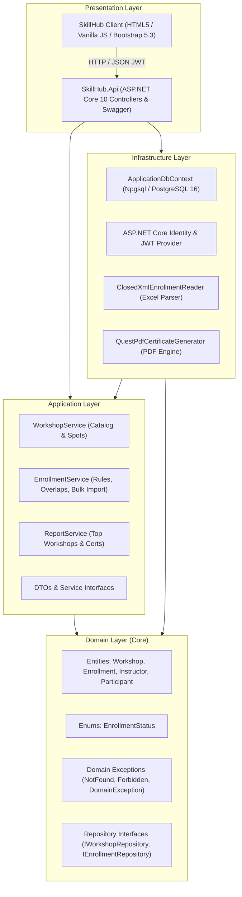

<div align="center">

# 🎓 SkillHub — In-Person Training & Workshop Management Platform
### *Enterprise .NET 10 Solution built with Clean Architecture, Domain-Driven Design & PostgreSQL in Docker*

[](https://dotnet.microsoft.com/)
[](https://www.postgresql.org/)
[](https://www.docker.com/)
[](https://getbootstrap.com/)
[](#architecture-overview)

<p align="center">
  A production-ready workshop management platform developed for <strong>SkillHub</strong>, replacing error-prone spreadsheets with automated capacity management, schedule overlap prevention, transactional bulk Excel onboarding, and instant cryptographic PDF certificate issuance.
</p>

</div>

---

## 📑 Table of Contents
1. [Executive Summary & Problem Statement](#-executive-summary--problem-statement)
2. [Core Domain & Business Rules](#-core-domain--business-rules)
3. [Architecture Overview & Dependency Graph](#-architecture-overview--dependency-graph)
4. [Technology Stack](#-technology-stack)
5. [Database Design & Docker Setup](#-database-design--docker-setup)
6. [Getting Started & Local Execution](#-getting-started--local-execution)
7. [Default Seeded Credentials](#-default-seeded-credentials)
8. [RESTful API Specification & Testing Guide](#-restful-api-specification--testing-guide)
9. [Bulk Excel Ingestion Protocol](#-bulk-excel-ingestion-protocol)
10. [Official Enrollment PDF Certificates](#-official-enrollment-pdf-certificates)
11. [Client Application (SPA)](#-client-application-spa)
12. [Deliverables Checklist](#-deliverables-checklist)
13. [Author & Academic Identification](#-author--academic-identification)

---

## 🎯 Executive Summary & Problem Statement

**SkillHub** is an educational academy delivering short, immersive, in-person workshops across creative and professional disciplines such as **Photography, Culinary Arts, Public Speaking, and Visual Design**.

### The Problem
Previously, student admissions were processed manually via web forms and spreadsheets. This manual workflow led to severe operational breakdowns:
- **Overbooking:** Workshops enrolled more students than the venue physical capacity.
- **Duplicate Enrollments:** Participants registered repeatedly for the same workshop.
- **Schedule Collisions:** Students inadvertently enrolled in overlapping workshops running at the exact same hour.
- **Uncontrolled Cancellations:** No audit trail of who cancelled or when, leading to inaccurate available spot calculations.

### The Solution
A decoupled, highly maintainable solution comprised of:
1. **A Modular REST API** enforcing strict domain invariants outside of HTTP controllers.
2. **A Responsive Participant Client** offering intuitive real-time workshop browsing, self-service enrollment, conflict alerts, and immediate PDF certificate downloads.
3. **An Automated Bulk Engine** enabling staff to upload Excel spreadsheets with row-by-row validation, atomic commits for valid entries, and comprehensive error logging.

---

## ⚖️ Core Domain & Business Rules

All domain rules are encapsulated strictly within the entity models (`SkillHub.Domain`) and application use cases (`SkillHub.Application`), ensuring business logic integrity regardless of consumer interfaces.

| # | Business Rule | Implementation Mechanism | Domain Validation Location |
|---|---|---|---|
| **1** | **Strict Capacity Limit** | MaxCapacity cannot be breached. Spots are computed dynamically: `MaxCapacity - Count(Active Enrollments)`. Cancelled records release spots immediately. | [`Workshop.cs`](src/SkillHub.Domain/Entities/Workshop.cs#L57) & [`EnrollmentService.cs`](src/SkillHub.Application/Services/EnrollmentService.cs#L143) |
| **2** | **No Duplicate Active Enrollments** | A participant cannot hold two `Active` registrations in the same workshop. | [`IEnrollmentRepository.cs`](src/SkillHub.Domain/Interfaces/IEnrollmentRepository.cs#L12) |
| **3** | **No Schedule Overlaps** | Intervals `[StartA, EndA]` and `[StartB, EndB]` cannot collide. Evaluated using interval intersection math: `StartNew < EndActive && EndNew > StartActive`. | [`EnrollmentService.cs`](src/SkillHub.Application/Services/EnrollmentService.cs#L152) |
| **4** | **Future-Only Workshops** | Workshops can only be created with future dates. Enrollments in ongoing or past workshops are strictly blocked. | [`Workshop.cs`](src/SkillHub.Domain/Entities/Workshop.cs#L49) |
| **5** | **Cancellation & Ownership** | **Participant:** Can only cancel their own enrollment and at least **24 hours prior** to workshop start.<br>**Employee:** Can cancel any enrollment anytime before start.<br>**Audit:** Every cancellation tracks `CancelledAt` (UTC) and `CancelledBy` (Email). | [`Enrollment.cs`](src/SkillHub.Domain/Entities/Enrollment.cs#L29) |
| **6** | **Re-Enrollment Eligibility** | A participant with a previously `Cancelled` enrollment can re-enroll in the same workshop if spots remain and no schedule collisions exist. | Fluent API filtered status indexing (no composite unique key blocking re-registration) |

---

## 🏛️ Architecture Overview & Dependency Graph

The solution strictly honors **Uncle Bob's Clean Architecture** and the **Dependency Inversion Principle (DIP)**. High-level policies never depend on low-level details.



### Layer Responsibilities
- **`SkillHub.Domain` (Pure C#):** Zero external NuGet dependencies. Defines core entities with encapsulated state mutators, domain exception hierarchy, and repository contracts.
- **`SkillHub.Application`:** Contains DTO definitions, use-case services, schedule conflict algorithms, and external service abstractions (`IExcelReader`, `IPdfGenerator`).
- **`SkillHub.Infrastructure`:** Implements data persistence using EF Core with PostgreSQL, Identity user stores, token minting, ClosedXML streaming, and QuestPDF rendering.
- **`SkillHub.Api`:** Houses thin API controllers, JWT authentication filters, CORS policies, Swagger generation, and a centralized `ExceptionHandlingMiddleware` mapping domain exceptions to HTTP status codes (`400`, `403`, `404`, `500`).
- **`client/`:** Participant SPA communicating via asynchronous `fetch` calls, storing JWT tokens in `localStorage`, and providing dynamic UI states.

---

## 💻 Technology Stack

### Backend (.NET 10)
| Component | Technology | Version | Purpose |
|---|---|---|---|
| Framework | .NET SDK / C# | 10.0.113 | Core runtime and modern C# features |
| Web Framework | ASP.NET Core Web API | 10.0 | RESTful controller endpoints |
| ORM | Entity Framework Core | 10.0.4 | Code-First relational mapping |
| Database Driver | Npgsql.EntityFrameworkCore.PostgreSQL | 10.0.3 | Native PostgreSQL EF Core provider |
| Security & Identity | Microsoft.AspNetCore.Identity | 10.0 | User credential management & hashing |
| Token Security | Microsoft.AspNetCore.Authentication.JwtBearer | 10.0.14 | Stateless API authentication |
| Excel Processing | ClosedXML | 0.105.0 | High-performance OpenXML spreadsheet ingestion |
| PDF Generation | QuestPDF | 2025.12.3 | Declarative, fluent PDF document composition |
| API Docs | Swashbuckle.AspNetCore | 10.3.1 | Swagger OpenAPI documentation |

### Database & DevOps
- **PostgreSQL 16 Alpine** running inside an isolated Docker container.
- **Docker Compose** orchestrating database storage volumes and network ports.

### Frontend Presentation
- **Vanilla JavaScript (ES6+):** Clean, lightweight client without heavy framework bloat.
- **Bootstrap 5.3 & Bootstrap Icons:** Modern responsive layout, modals, and tables.
- **Custom Design System:** Specialized palette featuring Forest Green (`#1b4332`), Warm Orange (`#e76f51`), Soft Cream Beige (`#fdfbf7`), and Deep Purple (`#6b21a8`).

---

## 🐘 Database Design & Docker Setup

The database schema is fully managed via Code-First migrations. The custom Docker configuration ensures portability across Linux, macOS, and Windows.

### Docker Compose Configuration (`docker-compose.yml`)
```yaml
services:
  skillhub-db:
    image: postgres:16-alpine
    container_name: skillhub-postgres-haren
    restart: always
    environment:
      POSTGRES_DB: skillhub_db
      POSTGRES_USER: haren_admin
      POSTGRES_PASSWORD: skillharen123
    ports:
      - "5434:5432"
    volumes:
      - haren_skillhub_data:/var/lib/postgresql/data

volumes:
  haren_skillhub_data:
```

### Relational Schema Highlights
- **`Workshops`:** `Id` (UUID PK), `Code` (Unique Index, e.g. `FOT-001`), `Title`, `Description`, `InstructorId` (FK), `StartDateTime`, `EndDateTime`, `MaxCapacity`.
- **`Enrollments`:** `Id` (UUID PK), `WorkshopId` (FK), `ParticipantId` (FK), `Status` (Int), `EnrolledAt` (Timestamp), `CancelledAt` (Nullable), `CancelledBy` (Nullable).
  - *Design Note:* Filtered indexing on `(WorkshopId, Status)` and `(ParticipantId, Status)` guarantees swift spot calculation without preventing historical re-enrollments.
- **`Instructors` / `Participants`:** Domain entities paired to Identity's `AspNetUsers` via unique `UserId` foreign keys.

---

## 🚀 Getting Started & Local Execution

### Prerequisites
- [.NET 10 SDK](https://dotnet.microsoft.com/)
- [Docker Engine & Docker Compose](https://docs.docker.com/get-docker/)
- Git CLI

### Step 1: Clone and Inspect
```bash
git clone <repository-url>
cd PRUEBA_SKILL
```

### Step 2: Spin Up PostgreSQL in Docker
```bash
docker compose up -d
```
Check container status:
```bash
docker ps --filter "name=skillhub-postgres-haren"
```

### Step 3: Launch the Backend API
```bash
dotnet run --project src/SkillHub.Api/SkillHub.Api.csproj --urls "http://localhost:5050"
```
> The API automatically verifies and applies pending EF Core migrations and seeds initial accounts, roles, and future workshops upon first boot.
>
> 🌐 **Interactive Swagger Documentation:** [http://localhost:5050/swagger](http://localhost:5050/swagger)

### Step 4: Launch the Participant Web Application
Open a new terminal window in the project root:
```bash
python3 -m http.server 3000 --directory client
```
> 🌐 **Participant Web Portal:** [http://localhost:3000](http://localhost:3000)

---

## 🔑 Default Seeded Credentials

The database comes pre-populated with ready-to-use accounts for immediate testing:

### 👔 SkillHub Employees (Instructors)
*Can publish workshops, inspect attendees, upload Excel bulk lists, and view top reports.*

| Email | Password | Full Name | Specialty | Role |
|---|---|---|---|---|
| `carlos.mendoza@skillhub.com` | `SkillHub2026*` | Carlos Mendoza | Fotografía Profesional | `Employee` |
| `laura.gomez@skillhub.com` | `SkillHub2026*` | Laura Gomez | Cocina Internacional | `Employee` |
| `andres.restrepo@skillhub.com` | `SkillHub2026*` | Andres Restrepo | Oratoria y Comunicación | `Employee` |
| `mariana.rios@skillhub.com` | `SkillHub2026*` | Mariana Rios | Diseño Gráfico y UI | `Employee` |

### 🧑‍🎓 Registered Participants
*Can browse catalog, enroll in workshops, cancel within rules, and download certificates.*

| Email | Password | Full Name | Role |
|---|---|---|---|
| `juan.perez@example.com` | `SkillHub2026*` | Juan Perez | `Participant` |
| `ana.martinez@example.com` | `SkillHub2026*` | Ana Martinez | `Participant` |

---

## 📡 RESTful API Specification & Testing Guide

All protected endpoints expect a standard header: `Authorization: Bearer <your_jwt_token>`.

```
Base URL: http://localhost:5050/api/v1
```

### Authentication Endpoints (`/auth`)
- `POST /api/v1/auth/register` — Register a new participant.
  - Body: `{"fullName": "string", "email": "string", "password": "string"}`
  - Response: `201 Created` with Token and profile.
- `POST /api/v1/auth/login` — Sign in with email and password.
  - Body: `{"email": "string", "password": "string"}`
  - Response: `200 OK` with JWT Bearer Token, roles, and expiration.

### Workshops Endpoints (`/workshops`)
- `GET /api/v1/workshops` — Public list of upcoming workshops with calculated `availableSpots`.
- `GET /api/v1/workshops/{id}` — Public workshop detail view.
- `POST /api/v1/workshops` — *[Authorize: Employee]* Create a new workshop.
  - Body: `{"code": "FOT-002", "title": "...", "description": "...", "instructorEmail": "carlos.mendoza@skillhub.com", "startDateTime": "...", "endDateTime": "...", "maxCapacity": 20}`
- `GET /api/v1/workshops/{id}/enrollments` — *[Authorize: Employee]* List all participants enrolled in a workshop.

### Enrollments Endpoints (`/enrollments`)
- `POST /api/v1/enrollments` — *[Authorize: Participant]* Enroll authenticated participant in a workshop.
  - Body: `{"workshopId": "guid"}`
- `GET /api/v1/enrollments/mine` — *[Authorize: Participant]* List own active and cancelled enrollments.
- `PATCH /api/v1/enrollments/{id}/cancel` — *[Authorize: Owner or Employee]* Cancel enrollment.
  - Enforces the 24-hour anticipation rule for participants.
- `POST /api/v1/enrollments/import` — *[Authorize: Employee]* Multi-part form-data file upload (`.xlsx`).
- `GET /api/v1/enrollments/{id}/certificate` — *[Authorize: Owner or Employee]* Download official PDF certificate.

### Reports Endpoints (`/reports`)
- `GET /api/v1/reports/top-workshops` — *[Authorize: Employee]* Workshop ranking ordered by active attendees descending.

---

## 📊 Bulk Excel Ingestion Protocol

The endpoint `POST /api/v1/enrollments/import` supports importing participants in batches using Excel spreadsheets:

1. **Structure:** Reads the sheet named `"Enrollments"` (or the first sheet by default) with headers `ParticipantEmail` and `WorkshopCode`.
2. **Validation Engine:** Evaluates each row individually through all 5 business rules (Existence, Future Date, Capacity, Duplicates, and Schedule Collisions).
3. **Fault-Tolerant Processing:** Valid rows are committed atomically to the database, while invalid rows are captured with their **exact Excel row number** and failure explanation.

### Sample Response:
```json
{
  "enrolledCount": 14,
  "rejectedRows": [
    {
      "rowNumber": 5,
      "reason": "Participant 'pedro.inexistente@correo.com' does not exist."
    },
    {
      "rowNumber": 12,
      "reason": "Schedule conflict: workshop 'ORA-001' overlaps with workshop 'COC-001'."
    },
    {
      "rowNumber": 18,
      "reason": "No spots available for workshop 'COC-001'. Maximum capacity is 10."
    }
  ]
}
```

---

## 📄 Official Enrollment PDF Certificates

Implemented via **QuestPDF** under the `ICertificatePdfGenerator` abstraction in the Infrastructure layer:

- **Format:** High-resolution A4 document with corporate branding.
- **Restricted Access:** Only active enrollments (`Status == Active`) are eligible. Cancelled registrations throw a domain validation error.
- **Required Metadata Included:**
  - Header: Institutional **SkillHub** branding and document reference.
  - Title: Exact Spanish title `"Constancia de inscripción"`.
  - Student Data: Participant full name and email address.
  - Workshop Details: Code, Title, Assigned Instructor, and full start/end schedule in UTC.
  - Timestamps: Original registration timestamp (`EnrolledAt`) and live document generation date (`GeneratedAt`).

---

## 💻 Client Application (SPA)

The participant user interface is built with **Vanilla JS & Bootstrap 5.3**, styled with an eye-catching, cohesive color scheme:

- **Color Palette:**
  - 🌲 **Forest Green (`#1b4332`):** Brand navigation bar and institutional badges.
  - 🍊 **Warm Orange (`#e76f51`):** Action buttons, enrollment triggers, and key highlights.
  - 🌾 **Cream Beige (`#fdfbf7`):** Warm, distraction-free content backdrop.
  - 🔮 **Deep Purple (`#6b21a8`):** Workshop code badges and accent gradient.
- **Dynamic Interaction:**
  - Real-time catalog with compact 3-column cards (`col-lg-4`).
  - **Syllabus Highlights:** Each card displays real educational topics and takeaways.
  - **Live State Detection:** If an authenticated participant is already registered for a workshop, the card highlights green and the action button automatically changes to `✔ Inscrito en este taller` (preventing accidental duplicate clicks).
  - Self-service cancellation with modal confirmation and instant certificate download.

---

## 📦 Deliverables Checklist

- [x] **Clean Architecture Solution:** Separated projects `Domain`, `Application`, `Infrastructure`, `Api`, and `client`.
- [x] **Entity Framework Core Migrations:** Code-First schema generated and updated via CLI.
- [x] **ASP.NET Core Identity & JWT:** Role-based access control for `Employee` and `Participant`.
- [x] **Business Rules in Domain:** Schedule collision math, capacity calculations, and 24-hour cancellation rule verified.
- [x] **Bulk Excel Import:** ClosedXML reader processing spreadsheets with row-level error reporting.
- [x] **QuestPDF Certificate Generator:** PDF engine outputting official certificates.
- [x] **Presentation Layer:** Vanilla JS & Bootstrap client application covering all 6 participant user flows.
- [x] **Docker Integration:** Custom container `skillhub-postgres-haren` running PostgreSQL 16 on port `5434`.
- [x] **SQL Database Export:** Complete database dump exported at [`skillhub_dump.sql`](./skillhub_dump.sql).
- [x] **English Codebase & README:** 100% of code, variables, endpoints, and documentation in English.
- [x] **Git History:** Granular, incremental commit history detailing the evolution of every task.

---

## 👤 Author & Academic Identification

- **Full Name:** Haren
- **Clan / Cohort:** Cohorte 5
- **Role:** Full-Stack .NET Developer
- **Assessment:** Prueba de Desempeño .NET — SkillHub Platform
- **Institution:** Riwi Tech Training Center
